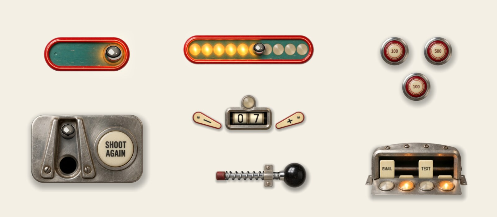

# Pinball UI

Ordinary UI controls as real pinball parts. A switch is a steel ball kicked across a short lane until it lands on a lamp. A slider is a ball rolling past ten lamps. A send button is a shooter rod you pull back until a ball drops in front of it. Delete is the drain, and undo is SHOOT AGAIN. The bodies are photographs, the ball is chrome drawn live so it mirrors whatever it rolls over, and every kick, clack, relay and chime is a recorded sound.

Under the pictures are real controls, so they work with a keyboard, a screen reader and a form. Each one is a single file that defines a custom element, with its photographs and sounds inside it, so there is nothing else to fetch. No dependencies, no build step for you, MIT licensed.



## The seven

| | element | what it does |
|---|---|---|
| [Toggle](toggle/) | `<pinball-toggle>` | A switch. The ball is kicked across, clacks into the far wall, rocks in its seat, and the lamp under it lights. |
| [Slider](slider/) | `<pinball-slider>` | A slider. The ball rolls along a lane of ten lamps; the lit lamps are the filled part. |
| [Plunger](plunger/) | `<pinball-plunger>` | Pull to send. Pull the knob all the way back, a ball drops in front of the tip, let go and it is knocked off the screen. |
| [Stepper](stepper/) | `<pinball-stepper>` | A number stepper. Two flippers either side of a score reel whose drums roll and carry. |
| [Drop targets](targets/) | `<pinball-targets>` | Up to four checkboxes. Tick one and a ball rolls in and knocks its target down; tick all four for the bonus. |
| [Drain](drain/) | `<pinball-drain>` | Delete with undo. Drain the ball; press SHOOT AGAIN while it blinks to kick it back out. |
| [Pop bumpers](bumper/) | `<pinball-bumper>`, `<pinball-bumpers>` | A button that pops and chimes, and a three-bumper cluster a ball ricochets around, scoring as it goes. |

## The look

A 1960s electromechanical pinball machine, close up and straight down: tomato-red plastic rims, teal painted wood, cream plastic inserts that glow amber from a bulb underneath, worn nickel-plated steel with slotted screws. Each body is one generated photograph, shot flat and front-on, with nothing in it that moves; the lit version of each is an edit of the unlit one, so lighting a lamp is a cross-fade between two photographs that line up to the pixel.

What moves is drawn in WebGL, one context for the whole page: the chrome ball (which reflects a small warm room above it and the lane around it, and whose scratches turn as it rolls), the springs, the score drums, the drop targets, the lamps' glow. The ball runs on a little physics: kicked, pulled toward its end, bounced off a wall, rocking to a stop in its seat. The lamps warm up from red to amber with one stumble, like an old bulb.

The sounds are recorded takes, several of each: a solenoid, the ball on a plastic wall, the ball knocking in its seat, a relay, a chime bar, and a rolling loop that follows the ball's speed. No two flips sound the same.

They are drawn for the cream page they were shot on, and they work on white or dark if you set `--pb-page`.

## Try them

Live: https://pinball-ui.vercel.app

Or run it yourself:

```sh
python3 -m http.server 8000     # from this folder
# open http://localhost:8000/
```

That opens the gallery, with all seven live. Turn the sound on.

## Use one

Each is a single file that defines an element. Install it with the shadcn CLI, which puts the file in `public/pinball-ui/`:

```sh
npx shadcn add finktheartist/pinball-ui/toggle
npx shadcn add finktheartist/pinball-ui/plunger
npx shadcn add finktheartist/pinball-ui/drain
# ...slider, stepper, targets, bumper
```

Or copy the file into your project by hand. Then load it with a plain script tag and use its element:

```html
<script src="toggle.js"></script>
<pinball-toggle name="alerts" label="Push alerts"></pinball-toggle>

<script src="plunger.js"></script>
<pinball-plunger label="Send"></pinball-plunger>        <!-- listen for send -->

<script src="drain.js"></script>
<pinball-drain window="6000"></pinball-drain>           <!-- delete, undo, commit -->
```

Each folder's README lists the attributes, properties, methods and events. The toggle, slider, stepper and drop targets fire `input` or `change` and work inside a `<form>` with a `name`.

- **Size.** `--pb-size` sets each control's height; the width follows. The defaults are real UI sizes (36 pixels for the toggle and slider). The photographs stay sharp up to about three times that.
- **Page colour.** Set `--pb-page` to your background as a hex colour, so the ball reflects it.
- **Sound** plays after the first press on the page, as browsers require. Add `silent` to an element to mute it, or set `PinballKit.sound = false` to mute them all.
- **How the files share.** Each file carries its photographs and a copy of the core (the clock, the custom-element base, the WebGL context, the ball's shader and the sounds, about 300 KB with the sounds). The first one loaded sets `window.PinballKit` and the others reuse it, so any mix of them shares one clock and one WebGL context.
- **The files are large,** because the photographs and sounds are inside them: 430 to 890 KB each. Load only the controls a page uses.

For agents, [llms.txt](llms.txt) lists every file and what it is. In the gallery each control has its install line and a "Copy a prompt" button; the prompt points a coding agent at the real file and tells it to wire it in, not redraw it.

## Make your own

`skills/pinball-ui/` is the workflow these were made by, written as a skill for a coding agent. Install it with:

```sh
npx skills add finktheartist/pinball-ui
```

Or copy the folder into your agent's skills folder by hand (for Claude Code, `~/.claude/skills/`). It has:

- `SKILL.md`, the workflow and the rules, most of them corrections from building this set.
- `core.js`, the core every control is built on, with the sounds.
- `starter.html`, the smallest whole example: a switch with no photographs, its lane worked out in the shader.
- `look.mjs`, which photographs a page at chosen moments after an action and saves the frames side by side, so the ball can be checked frame by frame.

An agent with the skill gets a reasonable first pass. These took many rounds of looking at stills, tuning the roll and listening, and yours will too.

[making-of/](making-of/) is how it was made: the directions that were dropped, how the plates were generated and lined up, how the ball is drawn, where the sounds came from, and every prompt.

## Working on this repo

- `core.js` is the source of the shared core. After editing it, or anything in `art/` or `sounds/`, run `node tools/build.mjs`, which stamps the core, the sounds from `sounds/` and each control's photographs from `art/NAME/` into every control file (between the `// >>> pinball core` and `// >>> art` markers) and into the skill. `node tools/build.mjs --check` exits 1 if any file is out of date.
- `tools/spec.mjs` says what each control is. `node tools/docs.mjs` writes every folder's `README.md` and `index.html`, the gallery, `registry.json` and `llms.txt` from it, so edit the spec and not those files. Run it after `build.mjs`, since it quotes the file sizes.
- `node tools/test.mjs http://localhost:8000/gallery/` uses every control with real touch and key events at phone width, checks the events, the form values and sideways scroll, and exits 1 on a failure. `node tools/shot.mjs URL OUT W H SCALE` takes a screenshot. Both need Chrome or Chromium (`CHROME=...` if it is somewhere unusual).

## Limits

- **Checked in headless Chromium,** with real touch and key events and stills of the controls. Not yet tried in Safari or Firefox, on a real phone, or with a screen reader, and the sound has not been heard on a phone.
- **Needs WebGL.** Without it the controls still work but nothing is drawn.
- **The photographs are fixed.** Labels you can change are printed live (the drop targets, the bumper caps, the plunger's name for screen readers); SHOOT AGAIN is part of the photograph. The drop-target bank has four slots and the bumper cluster three bumpers.
- **The plunger's ball crosses the page** above everything else for about a second, and the plunger does not yet change with `prefers-reduced-motion`. The other six put the ball where it ends up.
- **Not form-reset aware.** The form controls send their values, but a form's reset button does not put them back.

## License

MIT. See [LICENSE](LICENSE). The photographs were generated for this project (with GPT Image through Higgsfield, and a Gemini image tool) and the sounds with ElevenLabs sound effects. They are original: no real machine's name, maker, art or logo is used.
