# How it was made

Every body in Pinball UI is a generated photograph: the lanes, the shooter rod and its bracket, the flippers and the score-reel housing, the drop-target bank, the drain and the bumpers. The code draws what moves: the chrome ball, the springs, the score drums, the targets, the lamps' glow. Every sound is a recorded take. This is how it got there, including the directions that were dropped. Every prompt is in [prompts.md](prompts.md).

## 1. Three eras, then the wrong reading of a good reference

The first round tried three looks for the same six controls: an electromechanical 1960s machine, a 1990s dot-matrix machine, and a stripped modern one, plus a settings screen.

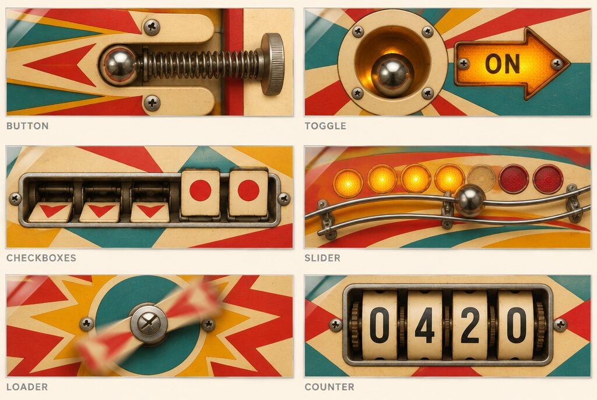

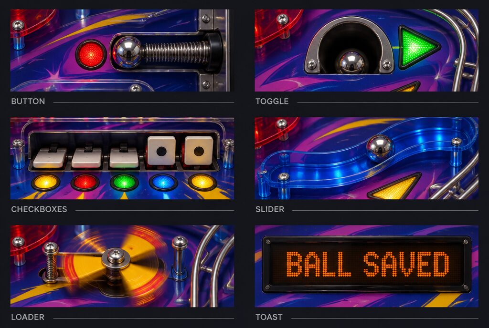

Then a board of about sixty reference pins, in six rows. The favourite was the first row: lit macro close-ups of real playfields, one warm bulb, a chrome ball, shallow focus. The next two rounds took that literally and made each control a macro photograph.

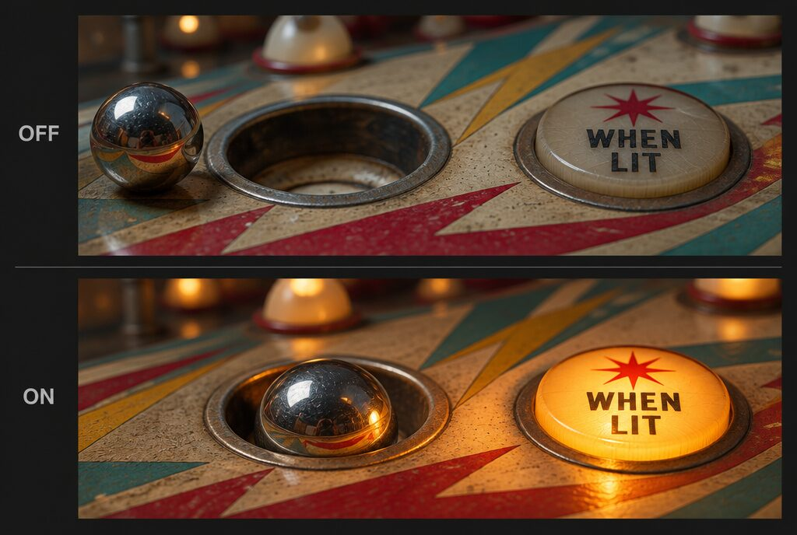

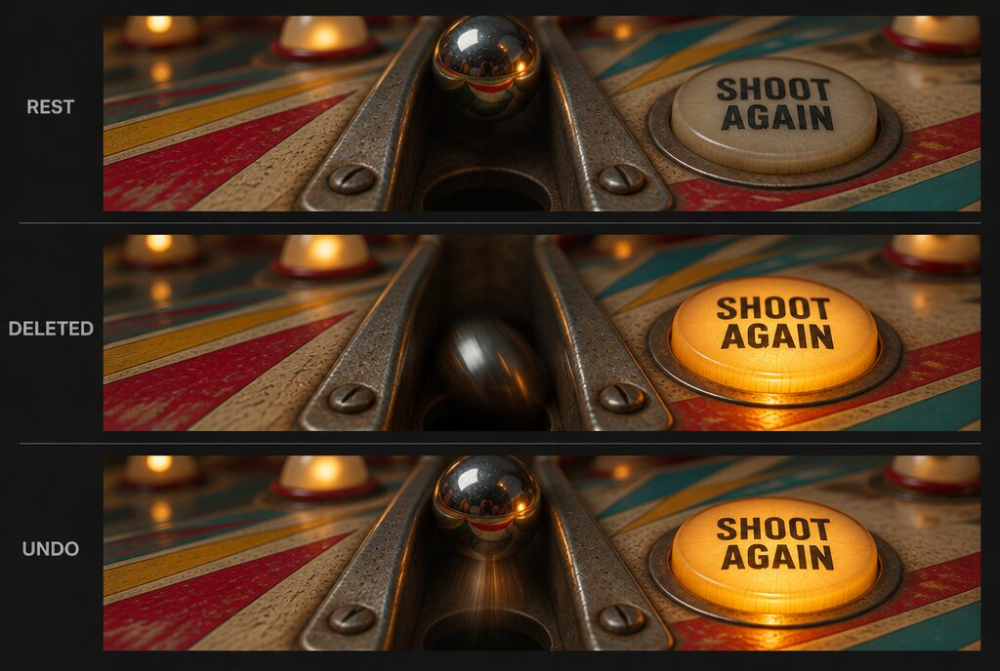

They were followed by a generated video clip of every control moving. The verdict was "these look nothing like UI components". Liking that row meant the subject (lit inserts, bumper caps, a chrome ball, warm glow), not photographs as controls.

## 2. Flat, front-on, real sizes

Round 4 drew the controls flat and front-on, at the sizes a real interface uses: each control as a drawn playfield part in an ordinary control shape.

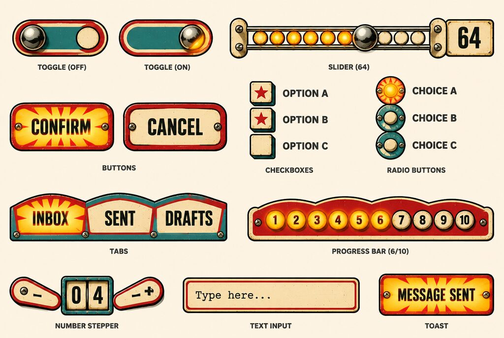

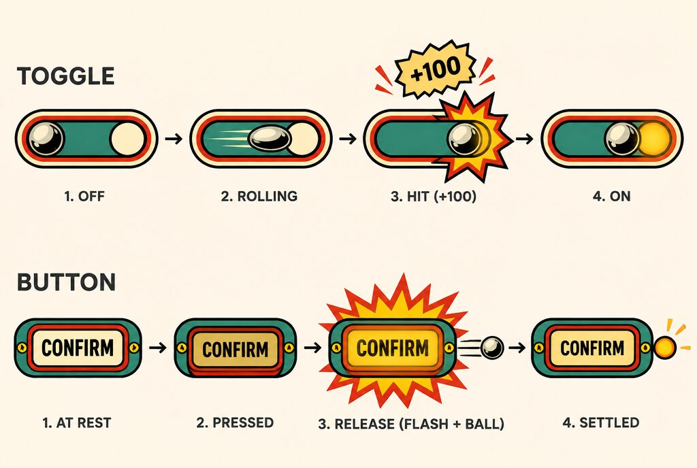

The next question was how to make them look real. Round 5 re-rendered the same sheets with real materials, changing only the rendering.

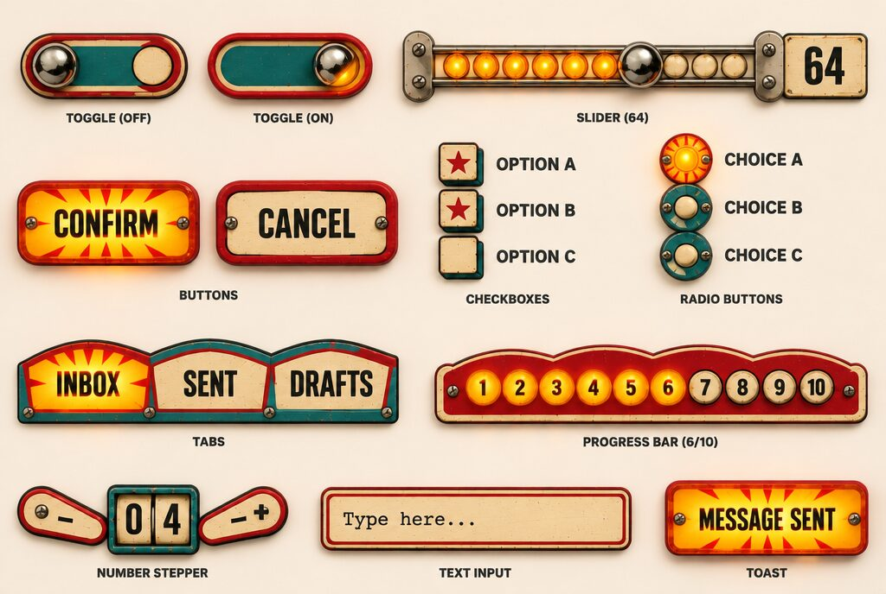

## 3. The toggle three ways

The method was settled on one control, built three ways side by side:

1. **Plates only:** two photographs of the body (lamp off, lamp on) and a photograph of a ball that slides.
2. **Plates with a live ball:** the same photographs, with the ball drawn in WebGL so it mirrors the lane under it and its scratches turn as it rolls.
3. **Full 3D:** nothing photographed; the body worked out in the shader as a lit relief.

The second won, and every control after it was made the same way. The third is still in the toggle (`mode="3d"`), so the three can be compared.

## 4. The plates

Each body was generated straight down and orthographic, with nothing in it the code draws: no ball in the lane, no numbers in the score window, no words on the drop targets.

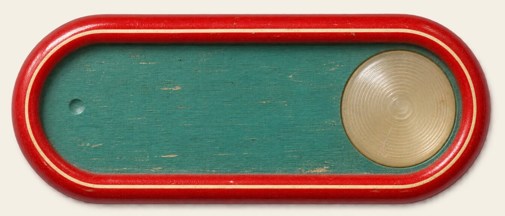

The lit version is an edit of the unlit one, with the unlit one as its reference and "change only the lighting", so the two line up to the pixel and lighting a lamp is a mix between them.

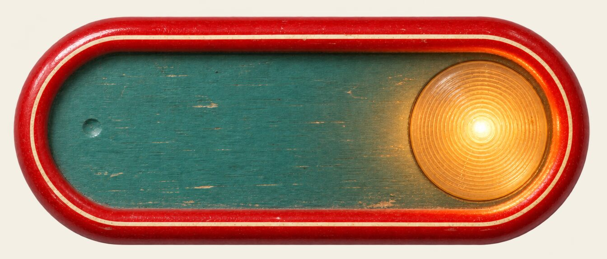

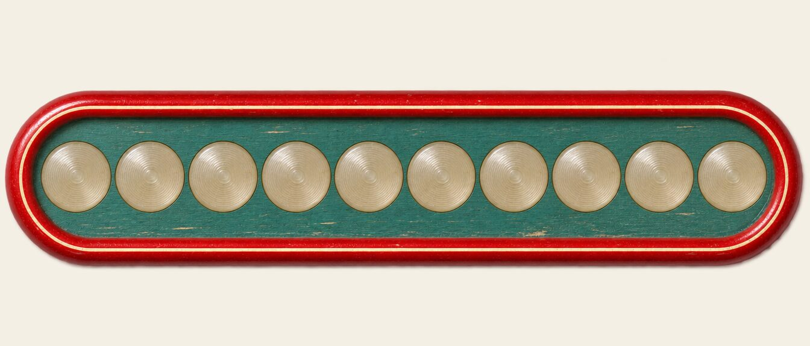

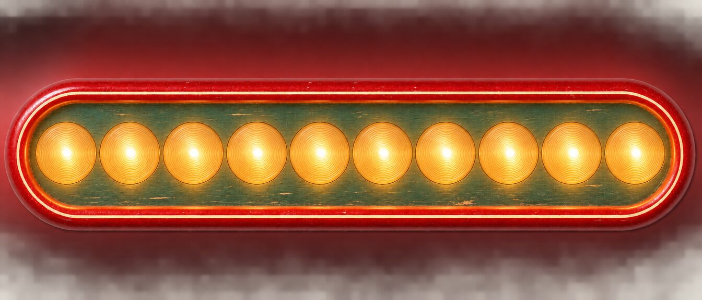

The later plates (stepper, flippers, drop-target bank, drain, bumpers) were made with a different image tool that could not give a transparent background, so they were asked for on pure white and cut out with a flood fill from the edge. Each was given earlier plates as references, so the steel, the lamps and the light match.

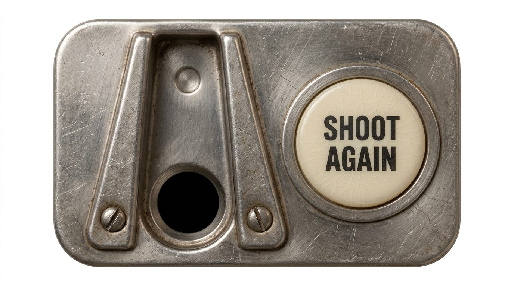

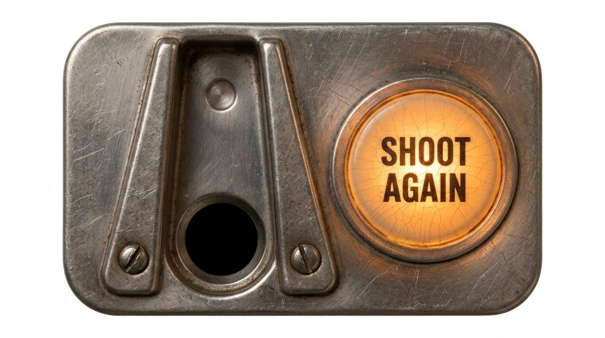

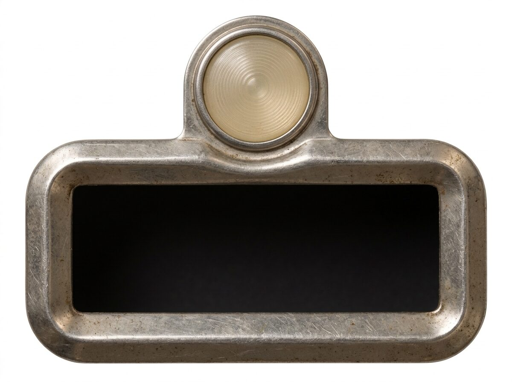

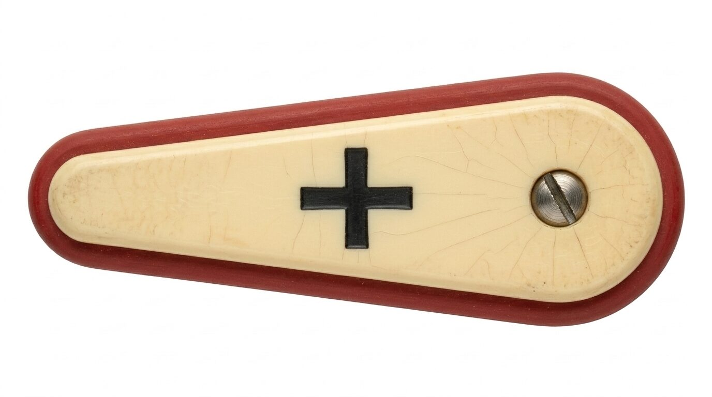

Every plate is measured once it is cut: the ball's seats, the walls, the lamp lenses, the window. Those numbers, in the plate's own pixels, are the constants at the top of each file.

## 5. The ball

The ball is the one thing every control shares, drawn by `core.js`. It mirrors a small imagined room above it (a pale ceiling, one big soft window, a few warm lamps) and the lane around it.

The first version was drawn the way the body is seen, from straight above. A mirror ball seen from straight above is a bright ring round a dark dot, and it read as an eye. The fix was to draw only the ball as if seen from in front and 37 degrees up, the way every photograph of a chrome ball is taken: the room in its upper half, a dark horizon, and the lane in front of it mirrored in its lower half by following each ray down to the floor. It read as chrome at once.

The ball moves along one line: a kick, a pull toward the far end, a wall a little past the seat that it bounces off, then a damped rock in the seat, each knock quieter. The lamp's switch closes the moment the ball reaches the seat over it, and the bulb warms up from red to amber with one stumble on the way.

## 6. The sounds

The first sounds were synthesised from noise and they were thin. They were replaced with takes generated by ElevenLabs sound effects, four per prompt: a steel ball hitting a plastic wall, a solenoid, a relay, a chime bar, and a ball rolling on wood, cut into a three-second loop. Takes were picked by their waveforms and spectra (one chime had no strike, one kick was a double, and the prompt for a soft tock gave several faint taps instead of one). A take is never played twice running and its speed is nudged each time, so no two flips sound the same. The slider's relay ticks rise in pitch along the row, and its chimes play a five-note scale.

## 7. The plunger, twice

The first plunger sat in a tray with a lens that lit up. The note back was that "the plunger should be the main mass of the component and look like a classic pinball knob. No encasing around the plunger and spring." It was rebuilt as a bare shooter rod: the knob, collar, rod and rubber tip are one photograph with a stretch of plain rod left out of the middle, and the bracket is another. The two springs are drawn live as round steel wire, after a flat striped coil looked fake. The ball first dropped where the tip rests at home, a whole pull away from the pulled-back tip; it now drops right in front of the tip, and the tip carries it forward.
